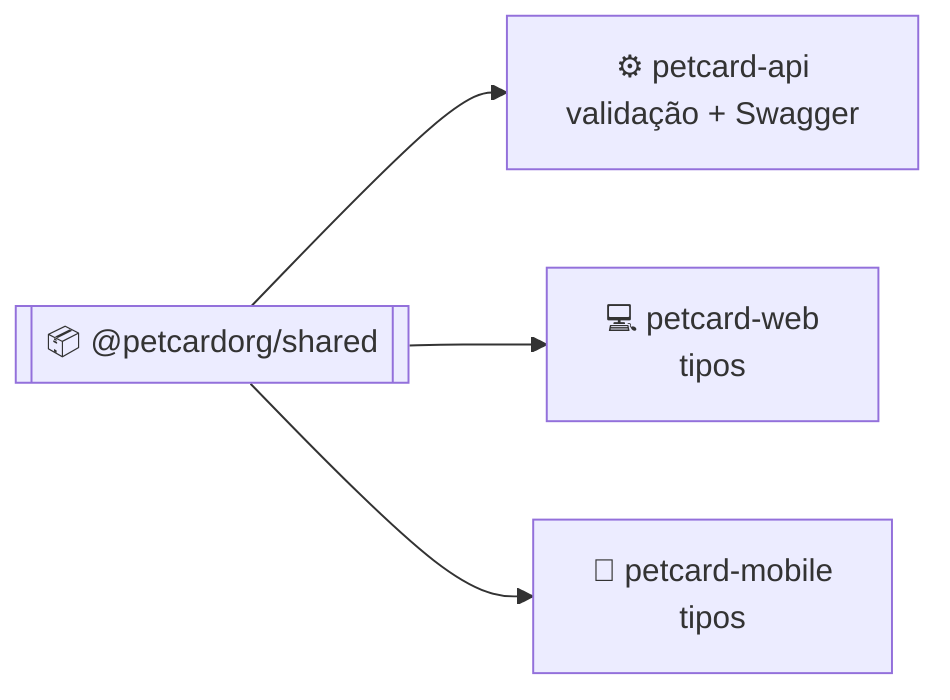

<div align="center">


# PetCard Shared

**Pacote `@petcardorg/shared`: os contratos (DTOs, enums e validadores) que a API, a web e o app usam para falar a mesma língua.**

[](https://github.com/PetCardOrg/petcard-shared/actions/workflows/ci.yml)
[](https://github.com/PetCardOrg/petcard-shared/actions/workflows/publish.yaml)
[](https://github.com/orgs/PetCardOrg/packages/npm/package/shared)
[](LICENSE)

[](https://www.typescriptlang.org)
[](https://github.com/typestack/class-validator)
[](https://github.com/orgs/PetCardOrg/packages/npm/package/shared)

[Por que existe](#por-que-existe) · [Instalação](#instalação) · [Uso](#uso) · [Conteúdo](#conteúdo) · [Desenvolvimento](#desenvolvimento) · [Publicação](#publicação) · [Ecossistema](#ecossistema)

</div>

---

## Por que existe

Quando o app envia um pet novo para a API, os dois lados precisam concordar sobre quais campos existem e quais são obrigatórios. Este pacote é a **fonte única** desses contratos: a API usa os DTOs para validar as requisições e gerar o Swagger, e a web e o mobile usam os mesmos tipos para montar as chamadas. Se um contrato muda aqui, o TypeScript aponta onde cada consumidor precisa se ajustar.



## Instalação

O pacote é publicado no GitHub Packages. No repositório consumidor, crie um `.npmrc`:

```ini
@petcardorg:registry=https://npm.pkg.github.com
//npm.pkg.github.com/:_authToken=${NODE_AUTH_TOKEN}
```

Depois, com um token do GitHub de escopo `read:packages` em `NODE_AUTH_TOKEN`:

```bash
npm install @petcardorg/shared
```

## Uso

```typescript
import { CreatePetDto, Species, Sex } from '@petcardorg/shared';

const pet: CreatePetDto = {
  name: 'Luna',
  species: Species.DOG,
  sex: Sex.FEMALE,
  breed: 'SRD (Vira-lata)',
  weight: 14.85,
};
```

Na API, os mesmos DTOs passam pelo `ValidationPipe` do NestJS, que aplica as regras do `class-validator` declaradas aqui.

## Conteúdo

```
src/
├── dtos/          um diretório por domínio
├── enums/         valores compartilhados
├── validators/    validadores customizados do class-validator
└── index.ts       exporta tudo
```

| Pasta         | O que tem                                                                                                                                                        |
| ------------- | ---------------------------------------------------------------------------------------------------------------------------------------------------------------- |
| `dtos/`       | `tutor`, `veterinario`, `pet`, `vaccine`, `deworming`, `medication`, `nota-clinica`, `anexo`, `historico-clinico`, `carteira-digital`, `clinica`, `notification` |
| `enums/`      | `Role`, `Species`, `Sex`, `DevicePlatform`, `AcaoClinica`, `CrmvMotivoRecusa`                                                                                    |
| `validators/` | Senha forte, normalização de e-mail, datas clínicas e campos opcionais que aceitam `null`                                                                        |

O build (`scripts/build.js`) usa o plugin do `@nestjs/swagger` como transformer: ele grava nos DTOs a metadata do OpenAPI, o que permite à API gerar o Swagger completo a partir de um pacote externo. A saída é JavaScript puro, sem dependência nova para a web e o mobile.

## Desenvolvimento

```bash
git clone https://github.com/PetCardOrg/petcard-shared.git
cd petcard-shared
npm install

npm run build        # gera dist/
npm test             # testes dos validadores (node:test)
npm run lint:check   # ESLint sem correção, como no CI
```

Os testes ficam em `test/`, fora do pacote publicado, e cobrem os validadores e as regras de DTO que têm lógica, como senha forte, paginação do histórico e campos que aceitam `null` no `PATCH`.

## Publicação

| Quando                      | O que acontece                                                                      |
| --------------------------- | ----------------------------------------------------------------------------------- |
| PR para `develop` ou `main` | O CI roda lint, build e testes, e **reprova** se `src/` mudou sem aumentar a versão |
| Push na `main`              | O workflow publica a versão do `package.json` no GitHub Packages                    |

O publish pula versões que já existem, então toda mudança de contrato precisa de bump. Diferente dos outros repositórios, aqui a `main` acompanha a `develop`, porque a API só consegue instalar versões que já foram publicadas.

| Mudança                                 | Versão                           |
| --------------------------------------- | -------------------------------- |
| Correção de tipo ou campo opcional novo | patch (`0.25.0` → `0.25.1`)      |
| DTO ou enum novo                        | minor (`0.25.0` → `0.26.0`)      |
| Remover ou renomear campo               | major (reservado para a `1.0.0`) |

## Ecossistema

| Repositório                                                    | O que é                                   |
| -------------------------------------------------------------- | ----------------------------------------- |
| [petcard-api](https://github.com/PetCardOrg/petcard-api)       | API REST em NestJS                        |
| [petcard-web](https://github.com/PetCardOrg/petcard-web)       | Área do veterinário em React + Vite       |
| [petcard-mobile](https://github.com/PetCardOrg/petcard-mobile) | App do tutor em React Native + Expo       |
| **petcard-shared**                                             | Contratos compartilhados (você está aqui) |
| [petcard-docs](https://github.com/PetCardOrg/petcard-docs)     | Documentação central, ADRs e board        |

Para contribuir, siga o [guia de contribuição](https://github.com/PetCardOrg/petcard-docs/blob/main/CONTRIBUTING.md). Projeto de TCC em Ciência da Computação, UNIFOR, 2026, por Álvaro Araújo, Camila Martins e Ricardo Temporal. Licença [MIT](LICENSE).
